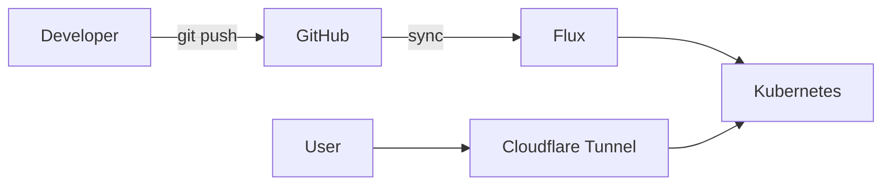

# Voluspa

This repository is managed declaratively with personal homelab powered by kubernetes and fluxcd.

> [!WARNING]
> This is a personal learning projoct.
> Not intended for production use, so Use at your own risk.

## Architecture



## Tech Stack

| Category | Tools |
|---|---|
| Orchestration | Kubernetes |
| GitOps | Flux |
| Secrets | Sealed Secrets |
| Auth | Pocket-ID |
| Storage | Longhorn |
| Networking | Cloudflare Tunnel, external-dns |
| Monitoring | Prometheus, Alertmanager |

## Repository Structure

```text
.
├── applications/        # End-user apps (Miniflux, dashy, ...)
├── infrastructure/      # Cluster services (Longhorn, monitoring, Cloudflare, ...)
└── platform/            # Shared services (Pocket-ID, ...)
```

## Boot strap command

``` bash
flux bootstrap github --owner=lillian0x --repository=voluspa --branch=main --path=./clusters/midgard --personal --token-auth
```

## Security

- Secrets are encrypted with Sealed Secrets before being committed.

## LICENSE

Released under the [MIT License](LICENSE)
